# Explorable

A desktop teaching and learning assistant for higher education, built with **Rust, Tauri 2, and SQLite**.

Explorable gives *answers you can interact with* for university courses. For each question the assistant chooses the most useful form of answer: a plain explanation, an interactive simulation, a quiz, a flashcard deck, a worked example, a lesson plan, or a rubric.

<p align="center">
  <a href="docs/media/tour.mp4">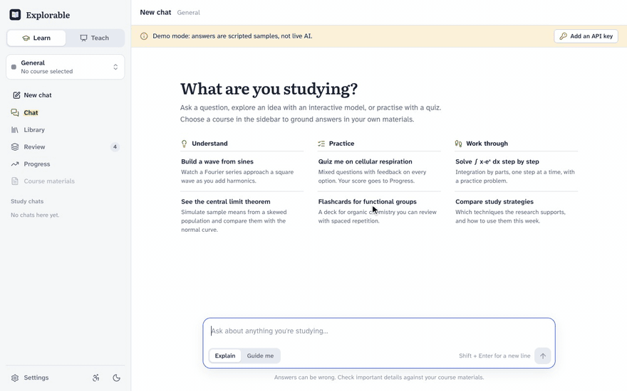</a>
</p>
<p align="center"><sub>A one-minute tour in demo mode. <a href="docs/media/tour.mp4">Open the MP4</a> for a sharper version.</sub></p>

- **Learn mode** (students): interactive explainers and simulations, quizzes with instant feedback, flashcards with spaced repetition, step-by-step worked examples, and progress tracking by topic. A *Guide me* style tutors with questions instead of handing over answers.
- **Teach mode** (instructors): lesson plans with measurable objectives and timed activities, assessments with answer keys and Bloom levels, analytic rubrics, and classroom demos with a full-screen Present view. Exports go to Moodle GIFT, Anki, CSV, Markdown, and standalone HTML.
- **Courses** keep chats, materials, saved items, and decks together. The assistant pitches answers at the course's level. It searches imported notes, syllabi, and readings (PDF, Markdown, text, HTML) and cites them by title.
- **Your choice of AI provider:** Claude (Anthropic), OpenAI, or Gemini (Google), with your own API key, or a scripted demo mode that needs no key.
- **Accessibility:** text size up to 150%, increased contrast, reduced motion, relaxed (dyslexia-friendly) spacing, a choice of reading font, and read-aloud for answers, including spoken math. Every setting also applies inside generated interactives.
- **Light and dark themes**, switched with one button in the sidebar ("Match system" is in Settings). Generated interactives follow the theme as well.

The plan written before the build is in [docs/PLAN.md](docs/PLAN.md).

## Screenshots

These come from demo mode, which replays scripted answers.

### Learn

<table>
  <tr>
    <td width="50%" valign="top">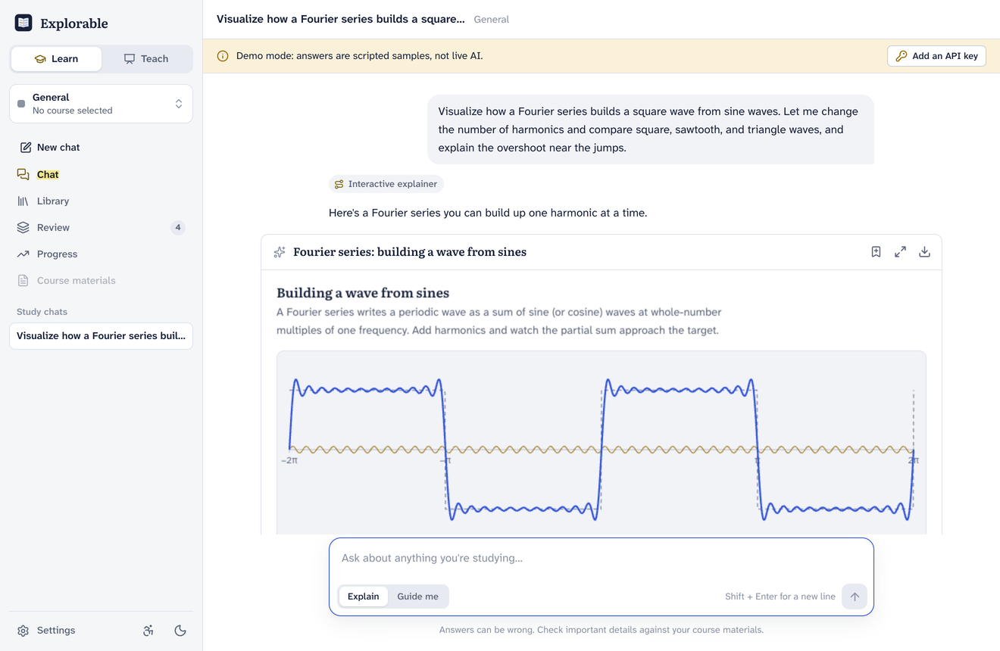<br><b>Interactive explainers</b> are written as the answer streams, then run in a sandboxed frame.</td>
    <td width="50%" valign="top">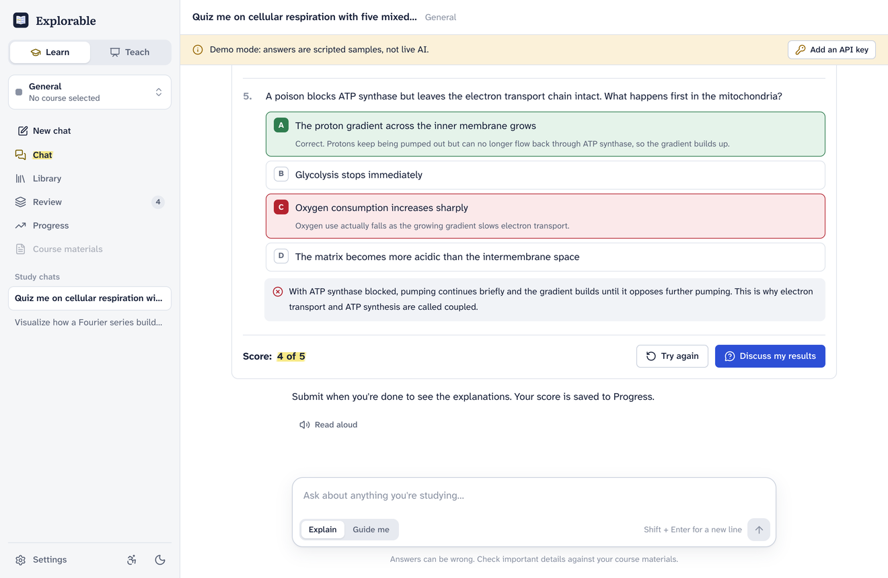<br><b>Quizzes</b> are graded on the spot, with an explanation for each option. Scores feed Progress.</td>
  </tr>
  <tr>
    <td width="50%" valign="top">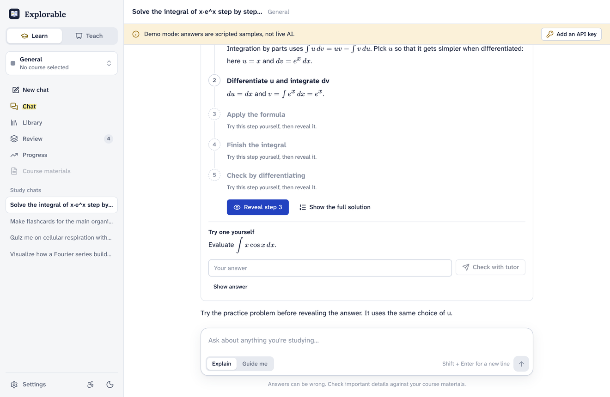<br><b>Worked examples</b> reveal one step at a time, then offer a similar problem to try.</td>
    <td width="50%" valign="top">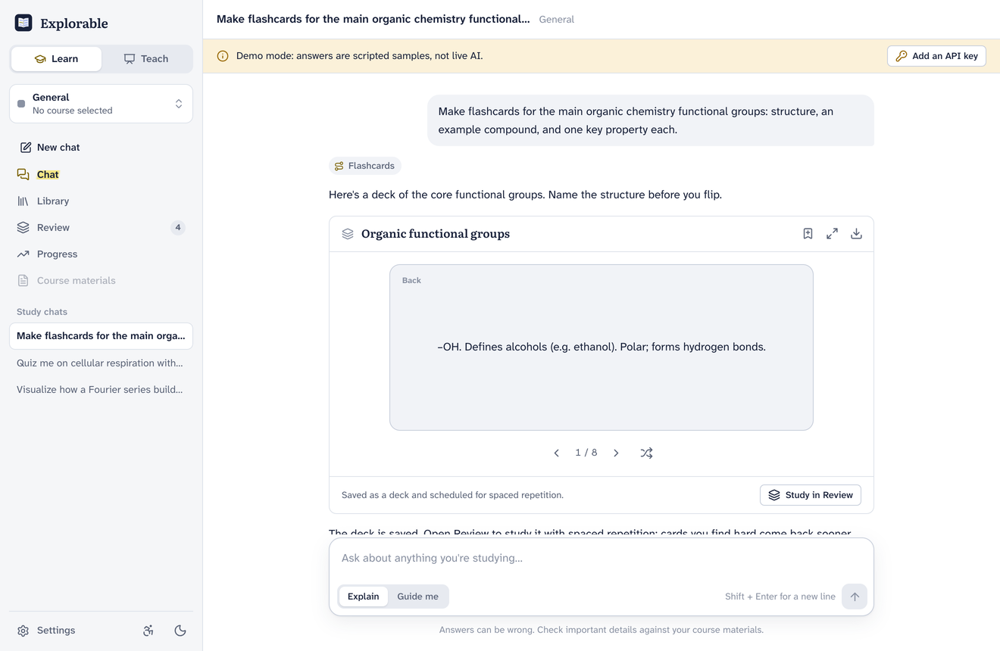<br><b>Flashcards</b> are saved as a deck for spaced repetition.</td>
  </tr>
  <tr>
    <td width="50%" valign="top">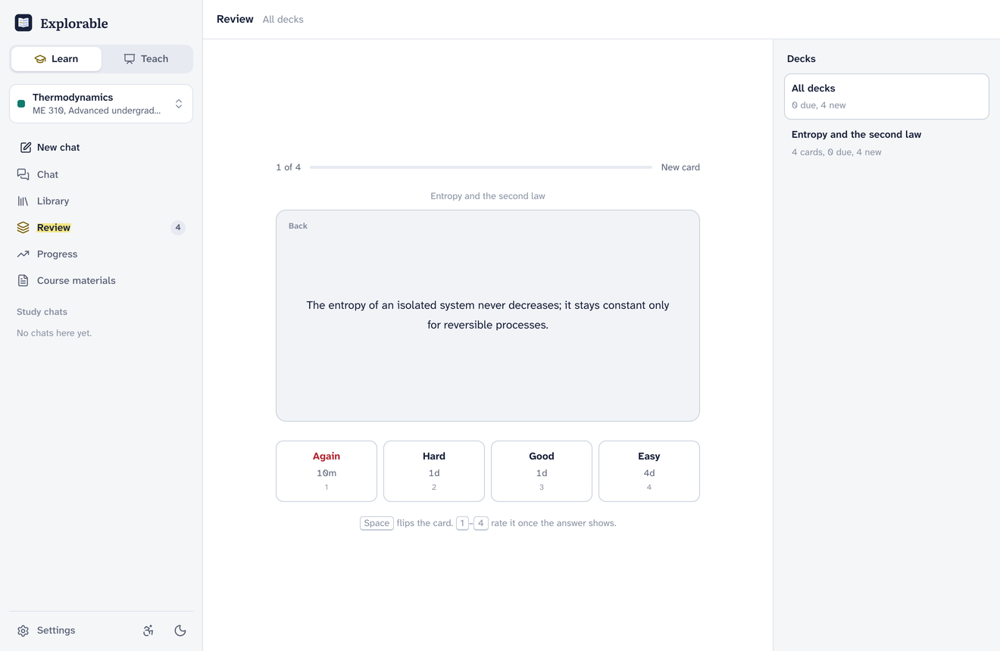<br><b>Review</b> brings cards back on a spaced-repetition schedule.</td>
    <td width="50%" valign="top">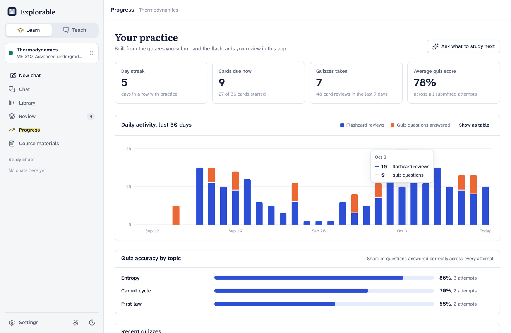<br><b>Progress</b> shows daily activity, streaks, and quiz accuracy by topic.</td>
  </tr>
</table>

### Teach

<table>
  <tr>
    <td width="50%" valign="top">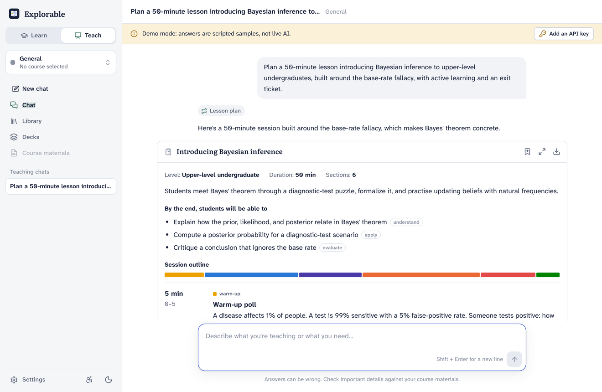<br><b>Lesson plans</b> have measurable objectives tagged with Bloom levels and a timed outline.</td>
    <td width="50%" valign="top">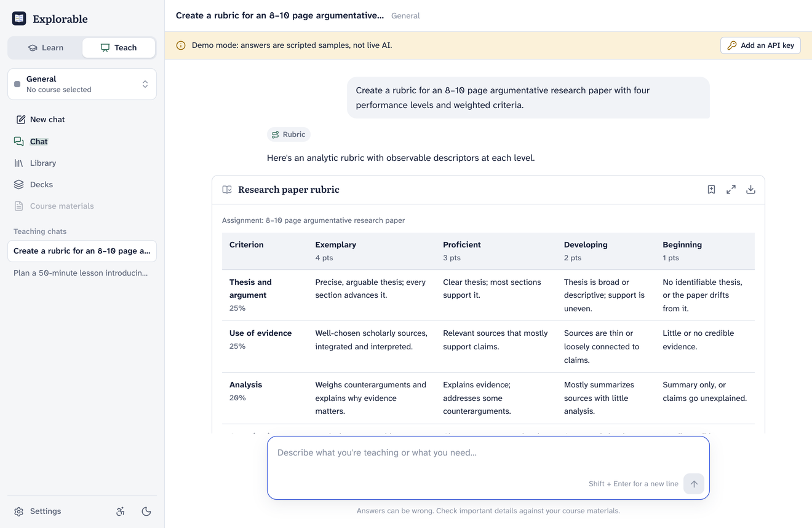<br><b>Rubrics</b> have weighted criteria and a descriptor for every performance level.</td>
  </tr>
  <tr>
    <td width="50%" valign="top">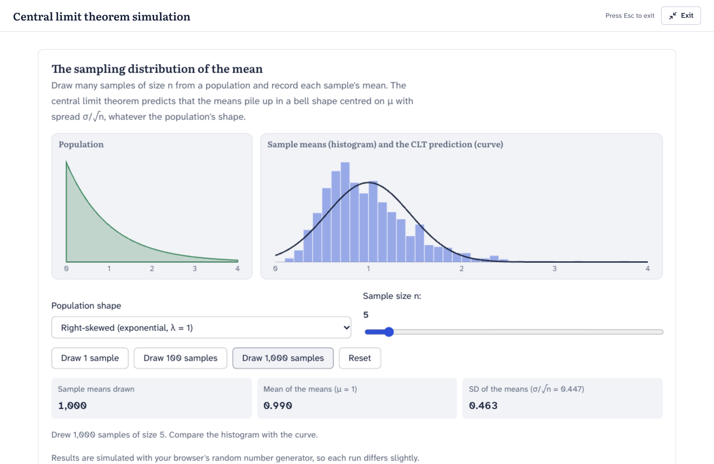<br><b>Present view</b> shows a demo full screen for the projector, and it stays interactive.</td>
    <td width="50%" valign="top">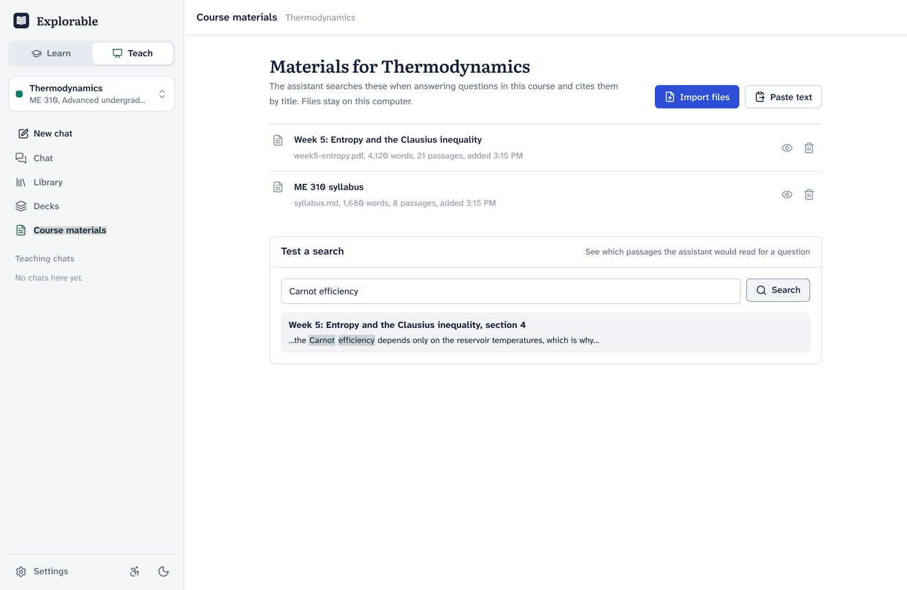<br><b>Course materials</b> are searched and cited by the assistant. You can test a search yourself.</td>
  </tr>
</table>

### Settings and accessibility

<table>
  <tr>
    <td width="33%" valign="top">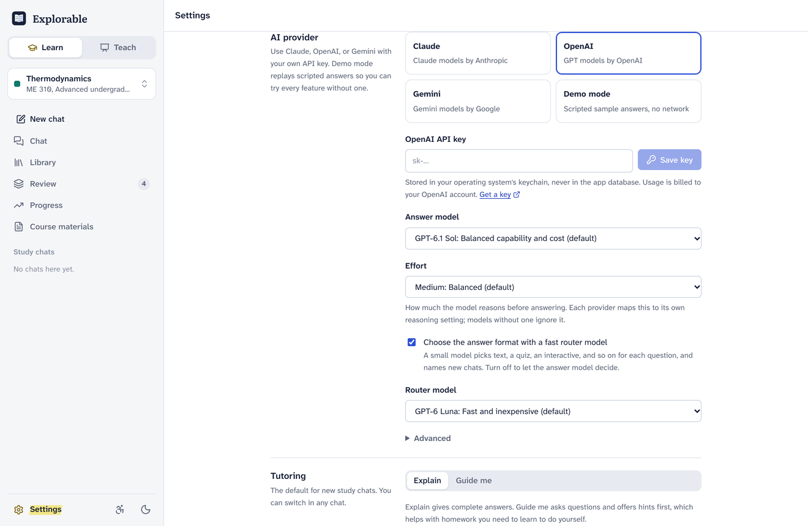<br><b>AI providers:</b> Claude, OpenAI, or Gemini, each with its own models and effort.</td>
    <td width="33%" valign="top">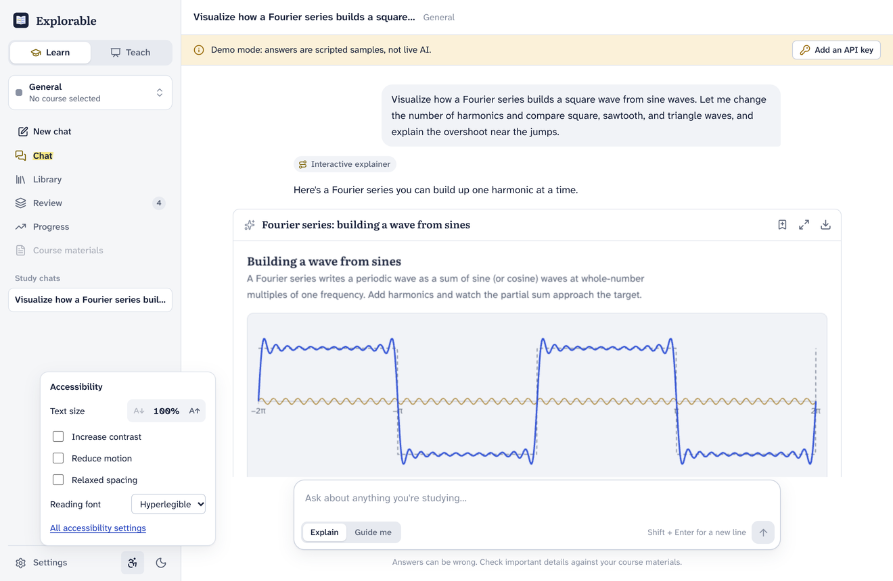<br><b>The accessibility menu</b> sits next to the theme button. Settings has the rest.</td>
    <td width="33%" valign="top">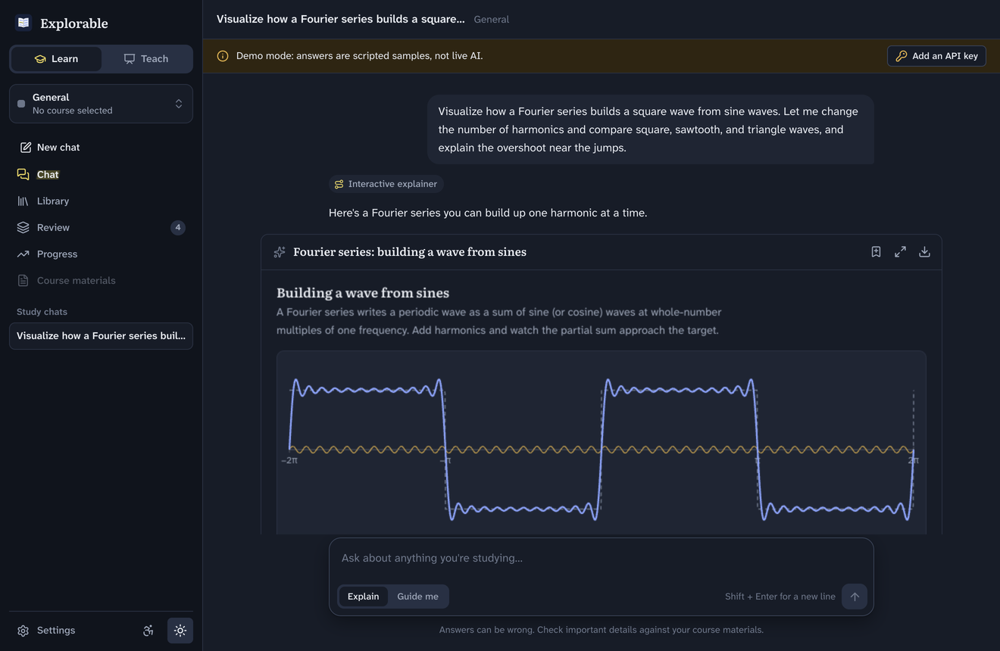<br><b>The dark theme</b> applies to generated interactives too.</td>
  </tr>
</table>

## Getting started

Prerequisites: [Rust](https://rustup.rs) 1.80 or later, Node.js 22 or later, and the [Tauri system prerequisites](https://tauri.app/start/prerequisites/) for your OS.

```bash
npm install
npm run tauri dev      # run the app with hot reload
npm run tauri build    # build an installable bundle
```

The app opens in **demo mode**, which replays scripted sample answers so you can try every feature without an API key. For live tutoring, open **Settings → AI provider**, choose a provider, paste its API key, and click **Test connection**. Keys are stored in the operating system keychain (macOS Keychain, Windows Credential Manager, or Secret Service on Linux), never in the database. The environment variables `ANTHROPIC_API_KEY`, `OPENAI_API_KEY`, and `GEMINI_API_KEY` (or `GOOGLE_API_KEY`) also work. A key saved in the keychain takes precedence over an environment variable.

| Provider | Answer models offered (default first) | Router and titles (default) |
| --- | --- | --- |
| Claude | Opus 5.5, Sonnet 5.5, Haiku 5.5, Haiku 4.5 | Haiku 5.5 |
| OpenAI | GPT-6.1 Sol, GPT-6 Astra, GPT-6 Luna, GPT-5.6 Sol, Terra and Luna, GPT-5.5, GPT-5.5 Pro | GPT-6 Luna |
| Gemini | Gemini 3.8 Flash, 3.1 Pro (preview), 3.5 Flash-Lite | Gemini 3.1 Flash-Lite |

Settings → AI provider → Advanced accepts any other model ID, and an API base URL for a compatible gateway. Effort (low, medium, high) maps to each provider's own reasoning control.

Provider differences you may notice:

- **Gemini** delivers each tool call whole, so a Gemini interactive appears when it's finished instead of building as it streams.
- **GPT-5.5 Pro** doesn't stream and can take several minutes per answer.

## How it works

```
React UI (webview)  ──invoke / Channel<ChatEvent>──▶  Rust core (src-tauri)
 Chat · Library · Review · Progress · Materials       agent loop · router · tools · prompt
 Renderers: Markdown+KaTeX, Quiz, Flashcards,          Claude, OpenAI, Gemini adapters (HTTP + SSE)
 WorkedExample, LessonPlan, Rubric, Table,             tolerant streaming JSON parser
 Choice, sandboxed InteractiveFrame                    SQLite (rusqlite, FTS5) · SM-2 · exporters
```

All application logic is in Rust. The TypeScript webview only renders.

Every provider's stream is translated into one canonical event format (shaped like the Claude Messages stream), so the agent loop, tools, and UI are identical across providers:

| Provider | API | Notes |
| --- | --- | --- |
| Claude | Messages API (SSE) | Adaptive thinking, prompt caching, eager tool-input streaming, refusal fallback |
| OpenAI | Responses API (SSE), stateless (`store: false`) | Reasoning items and message `phase` are round-tripped exactly; Pro models use a non-streaming path |
| Gemini | `streamGenerateContent` (SSE) | Thought signatures are round-tripped in the exact part they arrived on |

Provider-specific data that must survive between turns (encrypted reasoning, thought signatures) is kept in private `_`-prefixed fields on the stored blocks. It's sent back only to the provider that produced it, and stripped for the others, so a chat can switch providers midway.

One turn runs as follows:

1. **Route.** The question is classified by a small model using structured JSON output. The choices are text, table, chart, diagram, interactive explainer, simulation, calculator, worked example, quiz, flashcards, lesson plan, and rubric. The chip on each answer shows the choice. If the router fails, the app says so and lets the main model choose.
2. **Stream.** The answer streams from the chosen provider, with reasoning set to the chosen effort. Tool arguments pass through a partial-JSON parser and reach the UI as live snapshots, so an interactive takes shape while it is being written.
3. **Validate and run tools.** Each tool input is deserialized into a typed struct and checked: answer indexes in range, table rows matching the columns, rubric descriptors matching the levels. Invalid input goes back to the model as an error, and the model fixes it. Server tools search materials, read progress, and save decks. Render tools return a confirmation. `ask_choice` pauses the run until the user picks an option.
4. **Persist.** Every content block is stored verbatim in SQLite, append-only, so thinking signatures and tool pairs replay correctly.

### Generated interactives

The `generate_interactive` tool streams `title → initialHeight → placeholderMessages → css → html → jsFunctions → jsExpressions`. The UI shows a placeholder until the CSS arrives, then morphs partial HTML into a preview frame. When the HTML is complete, a final frame boots in the background and replaces the preview. The script channels then run once each, in order.

Frames are `<iframe sandbox="allow-scripts">` with an opaque origin, so they have no storage, no access to the parent page, and no Tauri IPC. Each frame carries its own CSP, which allows scripts only from esm.sh, jsDelivr, unpkg, and cdnjs. The only channel to the app is a small bridge:

- `edu.sendPrompt({ text })` requires a real click or key press inside the frame. The host also validates the text and rate-limits calls.
- `edu.openLink({ url })` accepts https only, is checked again in Rust, and opens the system browser.

Runtime errors appear under the frame with an **Ask to fix** action.

## Project layout

```
src/                     React UI
  chat/                  chat view, composer, starter prompts
  renderers/             one component per answer type; InteractiveFrame is the sandbox host
  sandbox/               frame documents, design system for generated UIs, partial-HTML handling
  views/                 Library, Review, Progress, Materials, Settings
  lib/                   typed command wrappers, store, theme, accessibility, grading, export helpers
  styles/                design tokens (colors, type, spacing) and component styles
src-tauri/src/
  agent/                 run loop, router, tools, system prompt, history rules, e2e tests
  llm/                   Claude, OpenAI and Gemini adapters, shared stream harness, model catalog, demo provider
  repo/                  SQLite queries per table
  commands/              Tauri command handlers
  db/                    connection and migrations
  partial_json.rs        tolerant parser for streaming tool arguments
  srs.rs                 SM-2 spaced repetition
  export.rs              Markdown, Moodle GIFT, CSV, Anki TSV
tests/e2e/               browser harness: mock IPC + Playwright checks and screenshots
tests/fixtures/          event streams recorded from the real agent
```

## Testing

```bash
npm run test:rust   # 94 Rust tests, including 15 end-to-end agent runs
npm test            # frontend unit tests (grading, partial HTML, spoken math)
npm run typecheck
npm run test:e2e    # drives the UI in Chrome against recorded agent output
npm run fixtures    # re-record tests/fixtures after changing starters or demo content
```

The end-to-end Rust tests run the real agent loop through a real IPC channel with the demo provider. They cover routing, streaming order (CSS before HTML), tool validation, deck creation, cancellation, retry, rejection of concurrent runs, and the choice pause. Each test also checks that the stored history stays valid for the API. OpenAI and Gemini runs go through a local mock HTTP server serving documented stream formats. Those tests check full tool loops and what each follow-up request sends back: reasoning items, `phase`, call IDs, thought signatures, and `functionResponse` parts. They also cover the router's structured output on both providers and the non-streaming Pro path.

The browser harness replays those recorded event streams into the real frontend through a mock IPC layer, then checks behavior inside the sandboxed frames. It covers isolation, the gesture requirement, the bridge, theme sync, accessibility settings inside frames, and both simulations running. It also tests quiz grading, provider settings, and layout overflow, and it saves screenshots of every view in both themes. It needs Google Chrome installed and port 1430 free.

**Not verified here:** live calls to Anthropic, OpenAI, or Gemini. The adapters are tested against the documented formats through a mock server, but a real tutoring session needs real keys. The release bundle is built and checked on macOS only.

## Troubleshooting

- **"Couldn't save the key to the system keychain" on Linux.** The keychain needs a running Secret Service provider, such as GNOME Keyring or KWallet. Start one, or set the provider's environment variable instead.
- **The app ignores your environment variable.** A key saved in the keychain takes precedence. Click **Remove** next to the key in Settings → AI provider, then restart the app.
- **A key or model is rejected.** Click **Test connection** in Settings → AI provider. Some models are available only to certain accounts. Pick another model, or enter a model ID your account can use under Settings → AI provider → Advanced.
- **OpenAI returns an error about organization verification.** Reasoning summaries can require a verified organization. The app retries without them, so answers still arrive.
- **An interactive stays blank or reports a missing library.** Interactives load libraries such as three.js, D3, Chart.js, and KaTeX from public CDNs, so they need an internet connection. Use **Ask to fix** under the frame for other runtime errors.
- **A PDF imports with no text.** Scanned PDFs have no text layer. Run OCR on the file (for example with `ocrmypdf`) and import it again.
- **There's no Read aloud button.** Check that **Show Read aloud buttons** is on in Settings → Accessibility. The button appears only when the system webview supports speech synthesis.

## Data and privacy

Everything is stored in one SQLite file in the app data folder, shown in Settings. Content is sent only to the AI provider you choose, and only when live tutoring is on. Course materials are indexed locally with SQLite FTS5.

## Contributing

Contributions are welcome. [CONTRIBUTING.md](CONTRIBUTING.md) explains:

- development setup
- the rules the code depends on
- how to add a model, a provider, or an answer type
- the checks a pull request needs

Testing with real API keys is especially useful right now, since no live provider call has been verified yet.

## License

Licensed under the [Apache License 2.0](LICENSE).

## Credits

Fonts: Atkinson Hyperlegible Next (Braille Institute) and Literata (TypeTogether), both under the SIL Open Font License.
